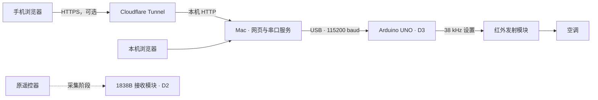

# COOLIX IR Controller

**把原遥控器的红外信号，变成手机上的空调控制器。**

Arduino UNO 负责发射，Mac 负责串口与网页服务，手机通过浏览器操作。项目以 YORK RG94A/BGEF 遥控器为实测对象，包含 COOLIX 状态编码、信号采集、特殊按键重放和需要访问码的移动端界面。

[](https://github.com/Awes0meE/coolix-ir-controller/actions/workflows/ci.yml)

> 网页显示**最近发送的设定**。空调没有回传通道，使用原遥控器后不会自动同步；串口发送完成也不等于空调已收到。

## 能做什么

- **普通状态控制**：AUTO / COOL / DRY / HEAT / FAN；17–30°C；微风、低、中、高四档。AUTO/DRY 锁定风量，FAN 不设温度。
- **11 个录制样本**：上下步进、左右 Swing、LED、Turbo、Sleep 两个样本、Silence 两个码、Follow Me / ION 长按、关机和固定开机样本。
- **手机界面**：深浅色随系统切换，大温度旋钮、模式与风量选择、开关、最近操作；支持添加到主屏幕。
- **有边界的发送**：一次操作只发一个完整按键报文，普通操作间隔至少 5 秒；重复请求不重发，结果不明不自动重试，启动和刷新不发射。
- **可追溯的协议数据**：72 条追加采集记录、144 个普通状态候选、原始串口日志、生成器和回归测试。

制热能力、Follow Me / ION 长按的实际功能，以及部分特殊键的 UNO 重放效果仍未确认。Sleep 样本会带入 **COOL、25°C、微风**，上下扇叶是相对步进。详细范围见[验证记录](docs/验证范围.md)和[协议说明](docs/COOLIX状态编码.md)。

## 工作方式



采集与控制使用不同固件。当前控制固件不会监听原遥控器更新。Mac 必须保持运行、UNO 保持连接，发射头能照到空调。Cloudflare 为可选远程入口，本地运行不需要它。

## 快速开始

目标硬件是经典 **UNO / UNO R3**，不是 UNO R4。使用 1838B 接收模块及带 MOS 驱动、限流的 940nm 发射模块。先按[硬件接线](docs/硬件与采集.md)连接。

已验证环境：macOS arm64、Python 3.9、Arduino CLI 1.5.1、AVR core 1.8.8、IRremote 4.7.1。CI 另检查 Python 3.11 和 UNO 编译。

### 1. 获取源码和工具

```sh
git clone https://github.com/Awes0meE/coolix-ir-controller.git
cd coolix-ir-controller

# 已安装 Homebrew 的 Mac
brew install python arduino-cli
python3 -m venv .venv
.venv/bin/python -m pip install -r controller/requirements.lock.txt

sh scripts/arduino.sh core update-index
sh scripts/arduino.sh core install arduino:avr@1.8.8
sh scripts/arduino.sh lib install 'IRremote@4.7.1'
sh scripts/arduino.sh board list
```

`scripts/arduino.sh` 优先使用项目内 `.tools/arduino-cli/arduino-cli`，否则使用 PATH 中的 Arduino CLI。开发板包和库放在本项目 `.arduino/`；需要自定义 CLI 时设置 `ARDUINO_CLI` 为可执行文件路径。

### 2. 编译并上传控制固件

```sh
sh scripts/arduino.sh compile --fqbn arduino:avr:uno sketches/ACStateControl
# 替换为实际 UNO 端口；上传前关闭串口监视器和已有控制服务
sh scripts/arduino.sh upload --fqbn arduino:avr:uno \
  --port /dev/cu.usbserial-XXXX sketches/ACStateControl
```

启动不自动发射。仓库已带生成好的 11 个按键样本；其他品牌或协议不能直接套用这些数据。

### 3. 启动本机网页

```sh
mkdir -p .runtime/controller
chmod 700 .runtime/controller
cp .env.example .runtime/controller/service.env
# 编辑 service.env，把 IR_SERIAL_PORT 改成实际 UNO 端口
sh controller/run.sh
```

打开 **http://127.0.0.1:8768**。首次运行会生成独立访问码，可在本机查看：

```sh
cat .runtime/controller/access-code.txt
```

登录后先确认“控制器在线”，调整模式、温度和风量，再点击“应用设置”。没有 UNO 时可以打开网页，但发射按钮不可用。

### 4. 手机远程访问与后台运行

用自己的域名和独立 Cloudflare Tunnel，将 HTTPS 主机名路由到 `http://127.0.0.1:8768`，并在私有 `service.env` 中设置同一 `IR_PUBLIC_ORIGIN`。

[部署与 MacBook Server 迁移说明](docs/手机控制网页与迁移.md)包含令牌保存、LaunchAgents、服务启停、端口配置，以及保留域名和令牌迁移的方法。凭据和数据库放在被 Git 忽略的 `.runtime/controller/`，本仓库不含可连接作者设备的凭据。

## 开发和验证

```sh
.venv/bin/python -m pytest -q tests
node --check controller/static/app.js  # Node 仅用于语法检查，运行网页不依赖 Node
.venv/bin/python scripts/generate_replay_catalog.py
git diff --exit-code -- sketches/ACStateControl/CapturedButtons.h captures/york-replay-index.json
.venv/bin/python scripts/check_public_tree.py
```

目前 24 项测试覆盖协议映射、异常采集、原始帧数、鉴权、模式限制、防重发和中断恢复。测试用假串口，**不会控制真实空调**。实物确认与软件测试分开记录；当前控制固件编译为 Flash 10994 bytes、静态 RAM 297 bytes。

## 项目地图

| 路径 | 内容 |
| --- | --- |
| `controller/` | FastAPI、串口控制、私有状态数据库和网页 |
| `sketches/ACStateControl/` | 当前控制固件与生成的原始波形 |
| `sketches/ACCapture/` | 长报文采集固件，只接收不发射 |
| `sketches/BoardCheck/`、`ReceiveProbe/`、`ACSendOnce/` | 诊断和最初单次验证工具 |
| `scripts/` | 编解码、采集解析、波形生成、服务安装和公开文件检查 |
| `captures/`、`logs/` | 经审查的协议数据、人工观察和原始串口证据 |
| `tests/` | 软件回归测试，不发红外 |
| `docs/` | [接线采集](docs/硬件与采集.md)、[协议](docs/COOLIX状态编码.md)、[部署迁移](docs/手机控制网页与迁移.md)、[验证范围](docs/验证范围.md) |

贡献前请阅读 [CONTRIBUTING.md](CONTRIBUTING.md)。第三方依赖与协议参考见 [THIRD_PARTY_NOTICES.md](THIRD_PARTY_NOTICES.md)。

## 许可证

许可证尚未指定；公开源码不等于授予复用许可。第三方依赖保留各自许可证。
